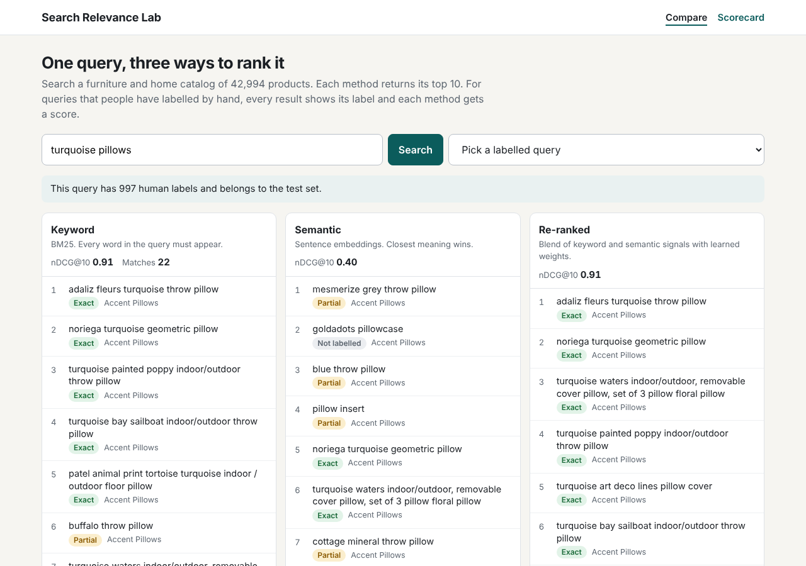

# Search Relevance Lab

**Compare keyword, semantic and re-ranked product search side by side, scored against human relevance labels.**

Live demo: [add the Render URL after the first deploy] · Current version: **v0.1.0** ([changelog](CHANGELOG.md))



## Why this exists

Search teams often argue about relevance from a handful of example queries. I wanted one place where the same queries run through three ranking methods and each one gets a number from labels that people made by hand.

The question I set out to answer: on the same catalog, how much does each step up in search technology buy, and where does it stop paying?

## What's inside

| Page | What it does |
|---|---|
| `/` | Runs one query through keyword, semantic and re-ranked search. Shows the top 10 from each, the human label on every result and nDCG@10 per method. |
| `/scorecard` | Totals for all four methods on 192 held-out test queries, the data caveats and a sortable table of every labelled query. |

## What I found

On the 192 test queries (scored 2026-11-16, open WANDS dataset):

| Method | nDCG@10 | Queries with no results |
|---|---|---|
| Keyword, every word must match | 0.406 | 60 |
| Keyword, any word may match | 0.704 | 1 |
| Semantic (embeddings only) | 0.497 | 0 |
| Re-ranked blend | 0.738 | 0 |

The biggest gain came from the cheapest change. Letting any query word match took nDCG@10 from 0.406 to 0.704. The learned blend added 0.034 on top of that. The [case study](docs/case-study.md) covers what is confirmed, what is still a guess and where my scoring is unfair to semantic search.

## How it works

- **Front end:** two plain HTML pages with no framework and no build step.
- **Server:** Node and Express. It builds a BM25 index in memory at start-up and compares embeddings by brute force.
- **Embeddings:** Universal Sentence Encoder, shipped inside an npm package. It runs on the server, so there is no API key and no per-query cost.
- **Data:** the catalog, queries, labels and product embeddings live in `/data` and are built by `scripts/build-data.mjs`.
- **Scoring:** `scripts/train.mjs` tunes the blend on train queries. `scripts/evaluate.mjs` scores everything and writes the file the scorecard reads.

## Run it locally

```
npm install
npm start
```

Open http://localhost:3000. No environment variables are required.

To rebuild the data from the source dataset:

```
git clone https://github.com/wayfair/WANDS
npm run build-data -- ../WANDS/dataset
npm run train
npm run evaluate
```

The embedding step takes about 15 minutes on two CPU cores. It saves its progress, so you can run it again if it stops.

## Product documentation

- [Product brief](docs/product-brief.md)
- [Case study](docs/case-study.md)
- [Decision records](docs/decisions)
- [Changelog](CHANGELOG.md)
- [Versioning](docs/versioning.md)

## Status and limits

- The data is a public research dataset about furniture and home goods. It is not live shop data, and results may not carry over to other catalogs.
- A product nobody labelled for a query counts as zero. That is unfair to semantic search, which often returns unlabelled products. See [decision 0001](docs/decisions/0001-count-unlabelled-results-as-zero.md).
- 14 query and product pairs had two different labels in the source file and were left out.
- The blend has four weights tuned by grid search. It is a small stand-in for Learning to Rank and uses no click data.
- Render's free plan sleeps. The first request after a quiet period can take a minute.

Data: WANDS (Wayfair ANnotation Dataset), https://github.com/wayfair/WANDS, MIT licence.
